### Grill 8.9 is here!

[Grill](https://github.com/theadamdanielsson/grill) is an AI agent for your Obsidian vault, on desktop and phone. It edits your notes, and it tests you on them and remembers what you got wrong. Now it edits in the note itself: select a passage, say what should change, and the new wording shows under it, word by word against the old. Nothing changes until you accept.

You can also paste a picture into the chat and ask about it, and a reply that changed notes shows the lines it added and removed, with one Undo for all of them.

- [What's new in 8.9](https://github.com/theadamdanielsson/grill/releases/tag/8.9.0)
- [Get it in Obsidian](https://community.obsidian.md/plugins/grill)
- [grill-test, for any agent](https://github.com/theadamdanielsson/grill/tree/main/skills/grill-test)
