### Grill 8.7 is here!

[Grill](https://github.com/theadamdanielsson/grill) tests you on your Obsidian notes and remembers what you got wrong. Now every chat starts from that record: what is due, where you are weakest, and the confusions still showing in your answers.

A wrong answer is kept with the reason it was marked down, so Chat can name the exact mistake. A confusion stays open while it keeps showing up and closes once it stops.

- [What's new in 8.7](https://github.com/theadamdanielsson/grill/releases/tag/8.7.0)
- [Get it in Obsidian](https://community.obsidian.md/plugins/grill)
- [grill-test, for any agent](https://github.com/theadamdanielsson/grill/tree/main/skills/grill-test)
