### Grill 8.8 is here!

[Grill](https://github.com/theadamdanielsson/grill) is an AI agent for your Obsidian vault, on desktop and phone. It edits your notes, and it tests you on them and remembers what you got wrong. Now it also gets your paper into the vault: pick a photo of handwriting, a slide, a scanned page or a PDF, and Grill writes it out as a note.

Formulas come out as LaTeX and tables as tables. A word it is unsure of is marked, and the note links to the original so you can check it. On a phone the picker opens the camera.

- [What's new in 8.8](https://github.com/theadamdanielsson/grill/releases/tag/8.8.0)
- [Get it in Obsidian](https://community.obsidian.md/plugins/grill)
- [grill-test, for any agent](https://github.com/theadamdanielsson/grill/tree/main/skills/grill-test)
